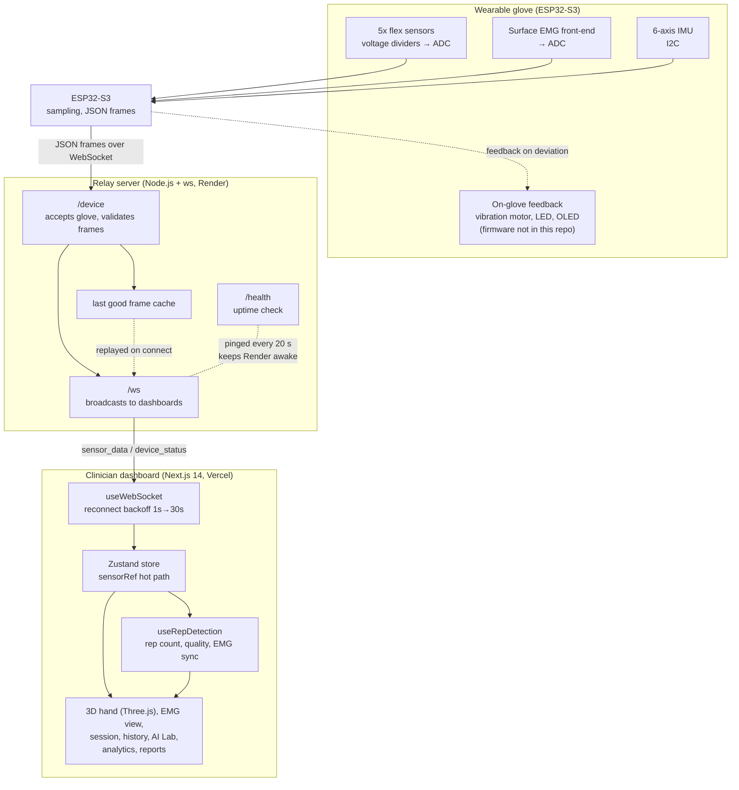

# RehabGrip

**Small movements, big possibilities.** RehabGrip is a wearable hand-rehabilitation monitor. A glove with flex sensors, a surface EMG channel and a wrist IMU streams live data to a clinician dashboard that shows a real-time 3D hand, counts reps, grades movement quality and generates patient reports.

> **Status: prototype.** RehabGrip is a research and demonstration prototype. It has not been clinically validated and must not be used for diagnosis or treatment decisions.

**Event:** NIRMAAN 2026 (Coding Club BMSIT × Alterino Club BMSIT), Healthtech & Bio-Wearables track.

---

## Contents

1. [Team details](#1-team-details)
2. [College / incubator information](#2-college--incubator-information)
3. [Project title](#3-project-title)
4. [Problem statement](#4-problem-statement)
5. [Healthcare use case](#5-healthcare-use-case)
6. [Technical stack](#6-technical-stack)
7. [AI / ML model or framework details](#7-ai--ml-model-or-framework-details)
8. [Demo video](#8-demo-video)
9. [Architecture diagram](#9-architecture-diagram)
10. [Presentation and hardware documents](#10-presentation-and-hardware-documents)
11. [Open-source license details](#11-open-source-license-details)
12. [Third-party and open-source declaration](#12-third-party-and-open-source-declaration)
13. [Public links](#13-public-links)
14. [Repository layout, setup and deployment](#14-repository-layout-setup-and-deployment)
15. [Known limitations](#15-known-limitations)

---

## 1. Team details

| Role | Name | Discipline |
|---|---|---|
| Team name | RehabGrip | |
| Team leader | Khush Chadha | Electrical & Electronics Engineering (EEE), 2nd year |
| Team member | Suraj Rajesh | EEE, 2nd year |
| Team member | Rajat AN | EEE, 2nd year |

---

## 2. College / incubator information

- **College:** BMS Institute of Technology & Management (BMSIT&M), Yelahanka, Bengaluru 560119, Karnataka, India. Autonomous institution under VTU.
- **Incubator:** [add incubator name, or write "Not applicable"]
- **Event:** NIRMAAN 2026, "Build. Innovate. Impact.", hosted by Coding Club BMSIT × Alterino Club BMSIT and powered by Mastry Hub × Reskill.
- **Track:** Healthtech & Bio-Wearables

---

## 3. Project title

**RehabGrip: Multimodal Hand Rehabilitation Measurement System (Model RG-2026)**

---

## 4. Problem statement

Home hand rehabilitation lacks real-time supervision and objective progress tracking between physiotherapy visits.

After a clinic visit, patients are usually prescribed hand exercises to do at home, with the next physiotherapy visit often 1 to 2 weeks away. During that gap there is no repetition count and no movement-quality data. Progress is judged from patient self-report, which is subjective and infrequent, so therapists often learn about poor technique or slow recovery late, and therapy adjustments are delayed.

---

## 5. Healthcare use case

**Who it helps**

| Group | Who | Why they benefit |
|---|---|---|
| Primary | Stroke, hand-injury and post-surgical patients doing home exercises | Objective feedback on how well each exercise is done between visits |
| Secondary | Physiotherapists and occupational therapists | Session data and trends to review and adjust the exercise program |
| Institutional | Outpatient clinics, home-care and tele-rehab services, community health programs | Remote monitoring that extends supervised rehab beyond the clinic |

**Clinical areas the sensing approach is designed for:** post-stroke upper-limb rehabilitation, hand osteoarthritis range-of-motion monitoring, carpal tunnel rehabilitation, Parkinson's motor assessment, and traumatic brain injury motor recovery.

**What the clinician sees:** per-finger range of motion, rep count and rep quality, EMG activation timing, wrist compensation (from the IMU), session history and trend charts, and an AI Lab that compares movement patterns against simulated reference profiles.

**Scale of the need (as stated in the project deck; sources to be added):** the deck states that 40 to 70% of stroke survivors globally have access to rehabilitation services, and that 63% or more of people needing rehab do not receive it.

---

## 6. Technical stack

| Layer | Technology |
|---|---|
| Glove controller | ESP32-S3 DevKit (dual-core 240 MHz, Wi-Fi and BLE) |
| Finger flexion | 5 × 2.2-inch resistive flex sensors, each in a voltage divider read by the ESP32 ADC |
| Muscle activity | Surface EMG front end (Muscle BioAmp Candy per the schematic), 3 Ag/AgCl electrodes on the forearm |
| Wrist motion | 6-axis IMU (MPU-6050, accelerometer and gyroscope) over I²C |
| Feedback | Vibration motor, status LED, 0.96-inch SH1106 OLED (132 × 64) over I²C |
| Power | 18650 Li-ion cell (3.7 V), TP4056 USB-C charging module, AMS1117-3.3 regulator |
| Enclosure | 3D-printed PLA |
| Relay server | Node.js, the `ws` WebSocket library and Node's `http` module; hosted on Render |
| Clinician dashboard | Next.js 14 (App Router), React 18, TypeScript, Tailwind CSS, Zustand, Three.js via `@react-three/fiber` and `@react-three/drei`, Framer Motion; hosted on Vercel |
| Data storage | No database in this version. The relay keeps state in memory, and the dashboard uses sample data from `lib/`. |

The glove firmware (ESP32 code) is **not included in this repository yet** (see [Known limitations](#15-known-limitations)).

---

## 7. AI / ML model or framework details

**Honest summary:** the current build does not contain a trained machine-learning model. Its intelligence is rule-based, and a learned classifier is on the roadmap.

**What runs today**

- **Rep detection** (`hooks/useRepDetection.ts`) is threshold-based with hysteresis. The mean flexion of the four long fingers is tracked. A rep starts when it rises above 15° and ends when it falls below 10°. The peak of each rep is graded: **correct** for 65° to 85°, **partial** for 30° to 65° or above 85°, and **missed** below 30°. Only correct and partial reps feed the average range of motion and the consistency score, where consistency = 100 × (1 − SD / mean) of the peak values.
- **EMG and finger synchronisation.** Over a sliding window of about 150 samples, the dashboard computes the Pearson correlation between the finger-flexion signal and the EMG envelope (`emgSync`). This indicates whether muscle activity and finger movement are moving together.
- **Wrist compensation.** Orientation is reconstructed from the IMU with a complementary filter in `hooks/useWebSocket.ts`, so wrist movement during an exercise can be flagged.
- **AI Lab** (`components/lab/`) is a demonstration. It compares the measured movement against ten *simulated* reference profiles (healthy, stroke mild, stroke severe, parkinsonian, essential tremor, carpal tunnel, hand osteoarthritis, cerebral palsy, early motor neuron disease, diabetic neuropathy). The profiles are labelled as simulated and are not clinical thresholds.

**Planned next (not yet implemented)**

- A lightweight classifier (Random Forest, SVM or logistic regression, trained with scikit-learn) on labelled repetitions, to flag incorrect or compensatory reps beyond fixed thresholds.
- On-device inference on the ESP32, so the glove works without a companion dashboard.

**Frameworks in use:** Next.js, React, Three.js, Zustand (the dashboard), and `ws` (the relay). Python and scikit-learn are planned for classifier training only.

---

## 8. Demo video

**Demo video (15 to 20 minutes, unlisted YouTube):** [ADD LINK HERE, e.g. https://youtu.be/XXXXXXXXXXX]

The dashboard can be demonstrated without any hardware. Run it in SIM mode (see [Getting started](#14-repository-layout-setup-and-deployment)), where a simulation panel drives the 3D hand, rep counting, EMG view, AI Lab and reports.

---

## 9. Architecture diagram

The diagram below shows the implemented system. It is also exported as [`docs/architecture/architecture.pdf`](docs/architecture/architecture.pdf) and [`docs/architecture/architecture.svg`](docs/architecture/architecture.svg), with the source in [`architecture.mmd`](docs/architecture/architecture.mmd).



The slide "System Architecture & Technical Implementation" in the project deck shows an earlier planned design, with direct BLE streaming to a companion app and an on-device classifier. The diagram above reflects what is in this repository: a WebSocket relay on Render and a Next.js dashboard on Vercel. The deck slide is kept in `docs/presentation/slides/` for reference.

---

## 10. Presentation and hardware documents

Every file is included individually so it can be opened without downloading the whole set.

| Document | File |
|---|---|
| Full presentation (8 slides) | [`docs/presentation/RehabGrip_NIRMAAN2026_Presentation.pdf`](docs/presentation/RehabGrip_NIRMAAN2026_Presentation.pdf) |
| Slide 1: Cover | [`docs/presentation/slides/01-cover.pdf`](docs/presentation/slides/01-cover.pdf) |
| Slide 2: Problem statement and real-world impact | [`docs/presentation/slides/02-problem-statement-and-impact.pdf`](docs/presentation/slides/02-problem-statement-and-impact.pdf) |
| Slide 3: Proposed solution and innovation | [`docs/presentation/slides/03-proposed-solution-and-innovation.pdf`](docs/presentation/slides/03-proposed-solution-and-innovation.pdf) |
| Slide 4: Product vision | [`docs/presentation/slides/04-product-vision.pdf`](docs/presentation/slides/04-product-vision.pdf) |
| Slide 5: System architecture (planned design) | [`docs/presentation/slides/05-system-architecture-planned-design.pdf`](docs/presentation/slides/05-system-architecture-planned-design.pdf) |
| Slide 6: Demo plan and roadmap | [`docs/presentation/slides/06-demo-plan-and-roadmap.pdf`](docs/presentation/slides/06-demo-plan-and-roadmap.pdf) |
| Slide 7: 24-hour build scope and feasibility | [`docs/presentation/slides/07-24h-build-scope-and-feasibility.pdf`](docs/presentation/slides/07-24h-build-scope-and-feasibility.pdf) |
| Slide 8: Team details | [`docs/presentation/slides/08-team-details.pdf`](docs/presentation/slides/08-team-details.pdf) |
| Operator's manual and clinical guide | [`docs/hardware-and-product/01-operator-manual-and-clinical-guide.pdf`](docs/hardware-and-product/01-operator-manual-and-clinical-guide.pdf) |
| Wrist module, exploded view and parts list | [`docs/hardware-and-product/02-wrist-module-exploded-view.pdf`](docs/hardware-and-product/02-wrist-module-exploded-view.pdf) |
| Electrical schematic | [`docs/hardware-and-product/03-electrical-schematic.pdf`](docs/hardware-and-product/03-electrical-schematic.pdf) |
| Mechanical dimensions | [`docs/hardware-and-product/04-mechanical-dimensions.pdf`](docs/hardware-and-product/04-mechanical-dimensions.pdf) |
| Technical specification sheet | [`docs/hardware-and-product/05-technical-specification-sheet.pdf`](docs/hardware-and-product/05-technical-specification-sheet.pdf) |
| Product poster: system overview | [`docs/hardware-and-product/06-product-poster-system-overview.pdf`](docs/hardware-and-product/06-product-poster-system-overview.pdf) |
| Product poster: marketing | [`docs/hardware-and-product/07-product-poster-marketing.pdf`](docs/hardware-and-product/07-product-poster-marketing.pdf) |
| Architecture diagram (PDF) | [`docs/architecture/architecture.pdf`](docs/architecture/architecture.pdf) |

---

## 11. Open-source license details

- **Project code:** released under the **MIT License**. See [`LICENSE`](LICENSE).
- **Main dependencies** (see `package.json` and `package-lock.json`): Next.js, React, React DOM, Three.js, `@react-three/fiber`, `@react-three/drei`, Zustand, Framer Motion and Tailwind CSS are MIT-licensed. TypeScript is Apache-2.0. The relay's `ws` library is MIT-licensed.
- **Embedded and hardware components:** the Arduino-ESP32 core is LGPL-2.1, and ESP-IDF is Apache-2.0. scikit-learn (planned) is BSD-3-Clause. The EMG front-end is a commercial module, and its reference design should be checked before redistributing any hardware files.

---

## 12. Third-party and open-source declaration

| Component | Used for | Status |
|---|---|---|
| Arduino / ESP32 core framework | Open-source embedded firmware base for the ESP32-S3 | In use (firmware not in this repo) |
| BLE GATT protocol | Open wireless standard, planned for direct glove-to-app streaming | Planned |
| scikit-learn (Random Forest, SVM, Logistic Regression) | Training the planned rep-quality classifier | Planned |
| Muscle BioAmp Candy (surface EMG front end) | Forearm EMG acquisition, per the schematic | In use (hardware) |
| Next.js, React, Three.js, Zustand, Framer Motion, Tailwind CSS, `ws` | Dashboard and relay software | In use (see `package.json`) |

Datasets: none. The project does not use external datasets. The AI Lab profiles are simulated and written in `components/lab/DiseaseEngine.ts`.

---

## 13. Public links

| Item | Link |
|---|---|
| Live clinician dashboard | [ADD VERCEL URL] |
| Relay server health check | [ADD RENDER URL]/health |
| Relay WebSocket for glove | wss://[ADD RENDER URL]/device |
| Demo video (unlisted) | [ADD YOUTUBE LINK] |
| Source code | This repository |

---

## 14. Repository layout, setup and deployment

```
.
├── app/                      # Next.js App Router pages
│   ├── session/               → live session view (3D hand, connect/disconnect)
│   ├── emg/                   → EMG waveform view
│   ├── patients/[id], /new    → patient list, profile, intake form
│   ├── history/               → past session history
│   ├── lab/                   → AI Lab: disease simulation and AI assessment
│   ├── analytics/             → aggregate metrics and trends
│   ├── reports/[id]           → generated session and patient reports
│   ├── settings/
│   └── layout.tsx, page.tsx   → root layout and redirect to /session
│
├── components/                # SidebarLayout, SessionPage, EMGPage, PatientsPage, HistoryPage,
│   │                          #   AnalyticsPage, ReportsPage, SettingsPage, CalibrationPage,
│   │                          #   SimulationPanel, MetricsPanel, HealthKeepalive
│   ├── hand/                  # HandScene, HandModel, ConnectionOverlay, OrientationWidget
│   ├── lab/                   # DiseaseEngine, LabHandScene, EMGWaveform, TrajectoryChart, AIAssessmentPanel
│   ├── patients/, reports/    # patient and report views
│   └── ui/Toast.tsx
│
├── hooks/
│   ├── useWebSocket.ts        # connects to the relay, parses frames (auto-reconnect, 1 s → 30 s backoff)
│   └── useRepDetection.ts     # rep counts, quality grades, consistency, EMG sync
│
├── store/handStore.ts         # Zustand store (hot-path sensorRef avoids re-renders)
├── types/                     # sensor.ts, lab.types.ts
├── lib/                       # formatters, sample data, report data, utils
│
├── server/                    # WebSocket relay (deploy separately, e.g. Render)
│   ├── index.js               # /device (glove) ↔ /ws (dashboards), /health, heartbeat, frame validation
│   ├── package.json, render.yaml, README.md
│   └── docs/useWebSocket.reference.ts   # original wire-format reference (not imported)
│
├── docs/                      # presentation, slides, hardware documents, architecture diagram
├── LICENSE
├── .env.local.example
├── .gitignore
└── package.json, package-lock.json, next.config.js, tailwind.config.js, postcss.config.js, tsconfig.json
```

> **Note on `server/docs/useWebSocket.reference.ts`:** this is the original hand-off snippet from when the relay's message format was designed. The dashboard's full implementation is `hooks/useWebSocket.ts`. The reference file is kept for context on the wire format and is not imported anywhere.

### Run the dashboard locally

```bash
npm install
npm run dev
```

Open `http://localhost:3000`. With `NEXT_PUBLIC_WS_URL` unset, the dashboard starts in **SIM mode** with an auto-cycling hand and no backend needed.

To connect to a real relay or glove:

```bash
cp .env.local.example .env.local
# edit .env.local and set NEXT_PUBLIC_WS_URL
npm run dev
```

Then open `/session` and click **Connect to Device**. The dashboard does not connect automatically on load.

### Run the relay server locally

```bash
cd server
npm install
npm start
```

Test it with `wscat`:

```bash
npx wscat -c ws://localhost:8080/ws
```

### Deployment

**Relay → Render**

1. Push this repository to GitHub.
2. Create a new Web Service on Render and connect the repository.
3. Root directory: `server` (already set in `server/render.yaml`).
4. Build command: `npm install`. Start command: `npm start`.
5. Copy the resulting Render URL.

**Dashboard → Vercel**

1. Import the repository in Vercel, leaving the root directory as the repository root.
2. Under Settings → Environment Variables, set `NEXT_PUBLIC_WS_URL` to `wss://<your-relay>.onrender.com/ws`. Vercel does not read `.env.local`.
3. Deploy.

### Data contract (relay ↔ dashboard)

| Message type | Meaning | Shape |
|---|---|---|
| `sensor_data` | Live frame from the glove | `{ deviceId, timestamp, flex:[index,middle,ring,pinky,thumb], emg:{value}, imu:{ax,ay,az,gx,gy,gz}, battery }` |
| `sensor_data_cached` | Last known frame, replayed on connect | Same shape as `sensor_data` |
| `device_status` | Connection state of the glove | `{ status: 'online' \| 'offline' \| 'stale' }` |

- `flex` values are calibrated angles in degrees (0 to 90), one per finger. The relay rejects frames that do not contain exactly five values in that range.
- IMU gyro values are in °/s, and the sensor is assumed to be mounted Y-up. Orientation is derived in the browser with a complementary filter. Yaw has no magnetometer correction and drifts, so press **R** in the session view to zero it.

### Simulation mode

Click the **⌥** control at the bottom-left of the session view to open the simulation panel:

- Toggle **SIM MODE** on or off.
- Drag per-finger sliders or choose presets.
- **AUTO CYCLE** runs a demo sequence.
- **NOISE** adds jitter.
- **SPEED** sets the per-frame smoothing factor (default `0.11` at 60 fps).

---

## 15. Known limitations

- **No trained ML model yet.** Rep quality and movement assessment use fixed rules. The learned classifier is planned.
- **Not clinically validated.** Thresholds, the AI Lab profiles and the sensing accuracy targets in the specification sheet are design targets, not results from a clinical study.
- **Firmware is not in this repository.** The ESP32 code that reads the sensors and sends frames should be added to a `firmware/` folder.
- **Prototype hardware.** The enclosure is 3D-printed PLA, and the glove is a development unit.
- **No persistent database.** Session and patient data are sample data in this version.
- **Hosting limits.** The relay runs on Render's free tier, which can sleep. The heartbeat and `HealthKeepalive` reduce this but do not remove it.
- **Yaw drift.** Without a magnetometer, yaw drifts over time.

---

*RehabGrip is a prototype for research and demonstration only. It is not a medical device and does not replace the judgement of a qualified clinician.*
