# RehabGrip

**Small movements, big possibilities.**

RehabGrip is a wearable hand-rehabilitation monitor. A glove with flex sensors, a surface EMG channel and a wrist IMU streams live data to a clinician dashboard that shows a real-time 3D hand, counts reps, grades movement quality and generates patient reports. Its v3 concept extends the same sensing to early arthritis forecasting.

▶️ **Watch the demo:** [RehabGrip - Small movements, big possibilities.](https://www.youtube.com/watch?v=i8S66JIVw8A)

[](https://www.youtube.com/watch?v=i8S66JIVw8A)


> [!WARNING]
> **Prototype only.** RehabGrip is a research and demonstration prototype. It has **not** been clinically validated and must **not** be used for diagnosis or treatment decisions.

**Event:** NIRMAAN 2026 (Coding Club BMSIT × Alterino Club BMSIT), Healthtech & Bio-Wearables track.

---

## At a glance

| | |
|---|---|
| **Project** | RehabGrip: Multimodal Hand Rehabilitation Measurement System (Model RG-2026) |
| **Problem** | Home hand rehab has no supervision or objective progress data between physio visits |
| **Solution** | Sensorised glove + wrist module + live clinician dashboard with rep counting, quality grading and reports |
| **Users** | Stroke, hand-injury and post-surgical patients; physiotherapists and occupational therapists; clinics and tele-rehab services |
| **Sensing** | 5 flex sensors, surface EMG, 6-axis IMU, vibration and OLED feedback |
| **Software** | WebSocket relay (Node.js, Render) and clinician dashboard (Next.js 14, Vercel) |
| **AI today** | Rule-based rep detection, grading and EMG–finger synchronisation. No trained model yet |
| **AI next** | Lightweight classifier for rep quality, then on-device inference on the ESP32 |
| **Roadmap** | Arthritis early-forecasting extension (v3 concept, not implemented) |
| **Try it now** | No hardware needed: run the dashboard in **SIM mode** (see [Quick start](#12-quick-start)) |

---

## Contents

1. [The prototype in pictures](#the-prototype-in-pictures)
2. [Team](#1-team)
3. [College and event](#2-college-and-event)
4. [Problem statement](#3-problem-statement)
5. [Solution overview](#4-solution-overview)
6. [Key features](#5-key-features)
7. [Healthcare use case](#6-healthcare-use-case)
8. [Arthritis early forecasting (v3 concept)](#7-arthritis-early-forecasting-v3-concept)
9. [System architecture](#8-system-architecture)
10. [Technical stack](#9-technical-stack)
11. [AI / ML model and framework details](#10-ai--ml-model-and-framework-details)
12. [Quick start](#12-quick-start)
13. [Deployment](#13-deployment)
14. [Data contract (relay ↔ dashboard)](#14-data-contract-relay--dashboard)
15. [Simulation mode](#15-simulation-mode)
16. [Repository layout](#16-repository-layout)
17. [Testing and quality](#17-testing-and-quality)
18. [Security and privacy](#18-security-and-privacy)
19. [Regulatory and ethical considerations](#19-regulatory-and-ethical-considerations)
20. [Presentation and hardware documents](#20-presentation-and-hardware-documents)
21. [Roadmap](#21-roadmap)
22. [Known limitations](#22-known-limitations)
23. [Licenses and third-party components](#23-licenses-and-third-party-components)
24. [Public links](#24-public-links)
25. [FAQ](#25-faq)
26. [Contributing](#26-contributing)
27. [Changelog](#27-changelog)
28. [Acknowledgements](#28-acknowledgements)

---

## The prototype in pictures

### The glove and wrist module

<p align="center">
  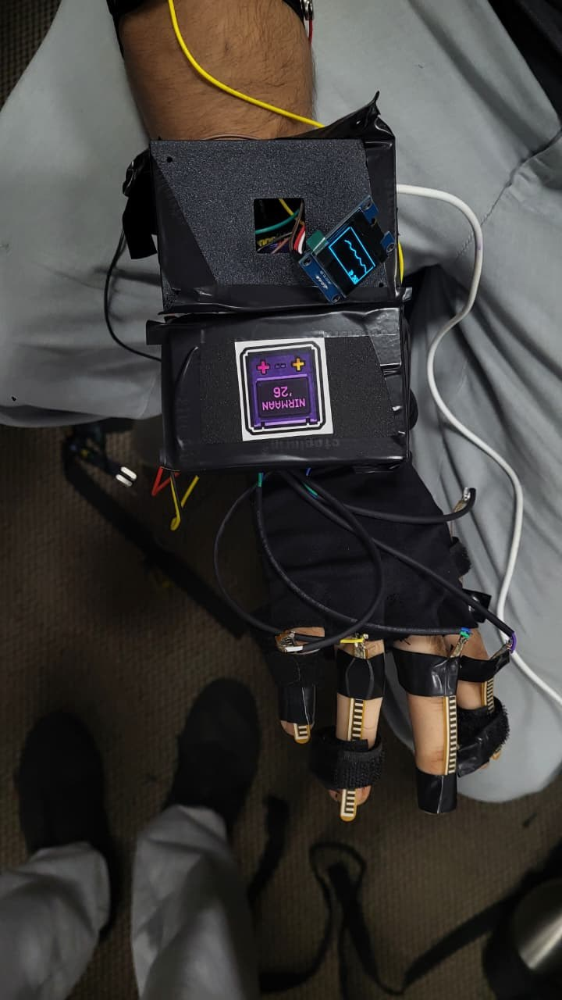
  &nbsp;&nbsp;
  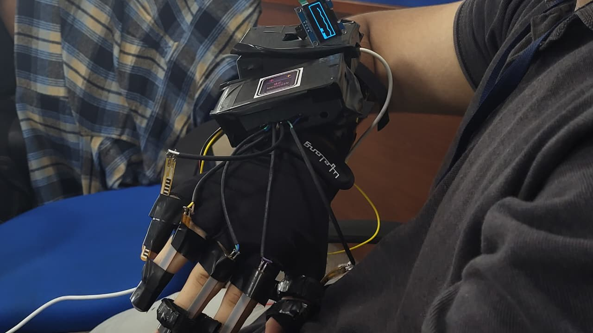
</p>
<p align="center"><em>Left: the wrist module and five-finger flex-sensor glove, with forearm EMG leads and the OLED status display. Right: close-up of the flex sensors along each finger and the wrist module.</em></p>

### The team and the prototype

<p align="center">
  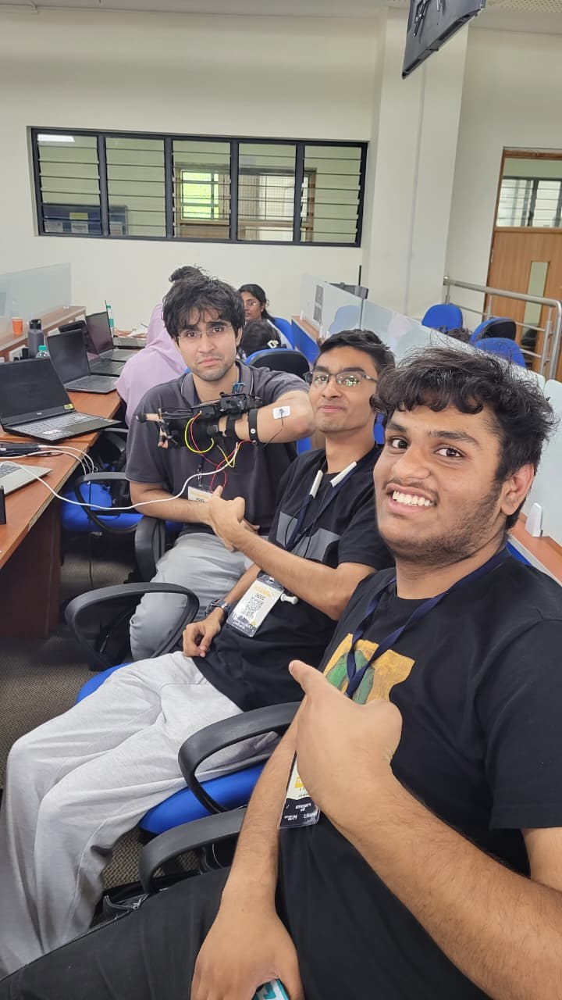
  &nbsp;&nbsp;
  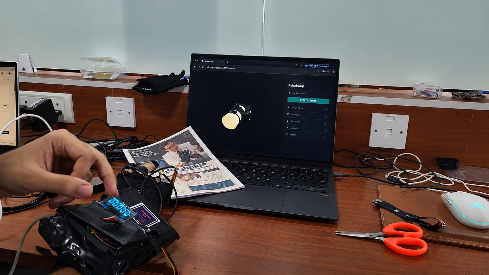
</p>
<p align="center"><em>Left: the team with the prototype during NIRMAAN 2026. Right: the live setup, with the wrist module beside a laptop running the dashboard at <code>localhost:3000/session</code>.</em></p>

### The clinician dashboard

<p align="center">
  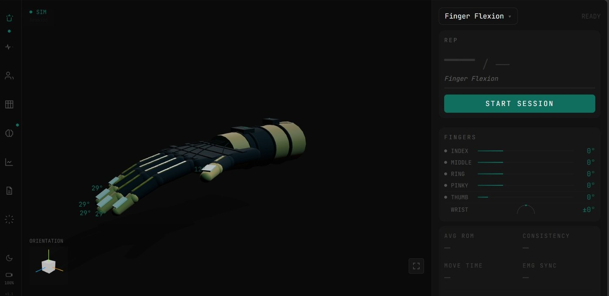
</p>
<p align="center"><em>Clinician dashboard in SIM mode: the 3D hand reflects per-finger angles, and the panel shows rep counting and session controls.</em></p>

---

## 1. Team

| Role | Name | Discipline |
|---|---|---|
| Team name | RehabGrip | |
| Team leader | Khush Chadha | Electrical & Electronics Engineering (EEE), 2nd year |
| Team member | Suraj Rajesh | EEE, 2nd year |
| Team member | Rajat AN | EEE, 2nd year |

---

## 2. College and event

- **College:** MS Ramaiah Institute of Technology (MSRIT), Bengaluru, Karnataka, India. Autonomous institution under VTU.
- **Incubator:** Not applicable.
- **Event:** NIRMAAN 2026, "Build. Innovate. Impact.", hosted by Coding Club BMSIT × Alterino Club BMSIT and powered by Mastry Hub × Reskill.
- **Track:** Healthtech & Bio-Wearables.

---

## 3. Problem statement

**Home hand rehabilitation lacks real-time supervision and objective progress tracking between physiotherapy visits.**

After a clinic visit, patients are usually prescribed hand exercises to do at home. The next physiotherapy visit is often 1 to 2 weeks away. During that gap there is no repetition count and no movement-quality data. Progress is judged from patient self-report, which is subjective and infrequent. Therapists often learn about poor technique or slow recovery late, and therapy adjustments are delayed.

**Scale of the need (as stated in the project deck; sources to be added):** the deck states that 40 to 70% of stroke survivors globally have access to rehabilitation services, and that 63% or more of people needing rehab do not receive it.

---

## 4. Solution overview

RehabGrip closes the gap between visits with three parts:

1. **A glove** that measures finger flexion, forearm muscle activity (EMG) and wrist motion (IMU), and gives local feedback through a vibration motor, LED and OLED.
2. **A relay server** that receives frames from the glove over WebSocket and fans them out to any number of dashboards.
3. **A clinician dashboard** that renders the hand in 3D, counts and grades reps, tracks trends and produces session and patient reports.

```
Patient at home ──► Glove + wrist module ──► Relay (Render) ──► Clinician dashboard (Vercel)
                     flex · EMG · IMU          WebSocket          3D hand · reps · reports
```

---

## 5. Key features

| Feature | What it does | Status |
|---|---|---|
| Live 3D hand | Per-finger angles drive a Three.js hand in real time | ✅ Working (dashboard) |
| Rep counting | Threshold-based detection with hysteresis (15° up, 10° down) | ✅ Working |
| Rep quality grading | Each peak graded correct, partial or missed | ✅ Working |
| Consistency score | 100 × (1 − SD / mean) of correct and partial peaks | ✅ Working |
| EMG–finger sync | Pearson correlation between flexion and EMG envelope over a ~150-sample window | ✅ Working |
| Wrist compensation | Complementary-filter orientation from the IMU flags wrist movement during exercises | ✅ Working |
| SIM mode | Full dashboard with no hardware, for demos and training | ✅ Working |
| AI Lab | Compares movement with 10 simulated reference profiles | ✅ Demonstration |
| Reports | Session and patient reports | ✅ Sample data |
| Auto-reconnect | WebSocket backoff from 1 s to 30 s | ✅ Working |
| Relay keepalive | Heartbeat and `HealthKeepalive` reduce Render sleep | ✅ Working (does not fully remove sleep) |
| On-device classifier | Learned rep-quality model running on the ESP32 | 🗓️ Planned |
| Arthritis forecasting | Daily joint-health score and decline forecasting | 💡 Concept (v3) |
| Persistent database | Stored patient and session history | 🗓️ Planned |

---

## 6. Healthcare use case

**Who it helps**

| Group | Who | Why they benefit |
|---|---|---|
| Primary | Stroke, hand-injury and post-surgical patients doing home exercises | Objective feedback on how well each exercise is done between visits |
| Secondary | Physiotherapists and occupational therapists | Session data and trends to review and adjust the exercise program |
| Institutional | Outpatient clinics, home-care and tele-rehab services, community health programs | Remote monitoring that extends supervised rehab beyond the clinic |

**Clinical areas the sensing approach is designed for:** post-stroke upper-limb rehabilitation, hand osteoarthritis range-of-motion monitoring, carpal tunnel rehabilitation, Parkinson's motor assessment, and traumatic brain injury motor recovery. Early arthritis forecasting (osteoarthritis and rheumatoid arthritis) is a planned extension, described in [section 7](#7-arthritis-early-forecasting-v3-concept).

**What the clinician sees**

- Per-finger range of motion
- Rep count and rep quality
- EMG activation timing
- Wrist compensation (from the IMU)
- Session history and trend charts
- An AI Lab that compares movement patterns against simulated reference profiles

---

## 7. Arthritis early forecasting (v3 concept)

> **Status: concept, not implemented.** The current code measures range of motion, EMG and wrist motion, but it has no arthritis model. This section comes from the RehabGrip v3 concept document, [`docs/concept/RehabGrip_v3_Arthritis_Forecasting.pdf`](docs/concept/RehabGrip_v3_Arthritis_Forecasting.pdf) (September 25, 2026).

**The problem.** Osteoarthritis, rheumatoid arthritis (RA) and post-traumatic arthritis progress slowly. Patients often notice stiffness or weakness months before diagnosis, and by the time blood tests and imaging confirm disease, joint damage may already be present. A clinic visit every few months can miss the early window when treatment has the most effect.

**What the glove would measure.** The sensors used for rehabilitation would also track early markers over days and weeks:

| Marker | Sensor | What a change may indicate |
|---|---|---|
| Declining range of motion | Flex sensors | Loss of finger flexion or extension over time |
| Morning stiffness pattern | Flex sensors, with time of day | Strength that recovers slowly after rest |
| Fine tremor change | IMU | Altered joint or muscle control |
| Left–right asymmetry | Flex sensors on both hands | One-sided onset, which is common in early RA |
| Fatigue slope | EMG | Faster strength loss across repeated grips |

**Planned method (design intent, not code)**

1. **Baseline (weeks 1–2):** record normal daily use to establish each person's reference values.
2. **Daily joint-health score:** combine more than 15 features, including range of motion, stiffness, tremor, asymmetry, EMG fatigue and recovery time after exertion.
3. **Trend detection:** fit a linear regression to the score and flag a sustained decline. The concept proposes flagging a decline faster than 2% per week.
4. **Forecast:** estimate how long a decline would take to reach a diagnostic threshold, so a clinician can review the patient earlier.

The concept proposes an interpretable decision-tree model, so a clinician can see which changes triggered a flag. For example: *"range of motion down 8%, tremor up, asymmetry detected."*

**Intended users:** people with a family history of RA or osteoarthritis, or raised inflammatory markers without symptoms; people in the years after a hand injury; and people with RA on disease-modifying drugs who need flare monitoring.

**Figures in the concept document.** The document reports a lab proof-of-concept (about 80% of predicted diagnosis dates within ±3–4 weeks on 50 RA patients), 85% specificity, cost-savings estimates and market sizes. **These have not been reproduced in this repository.** Treat them as targets or estimates until validated, and check the study citations before quoting them.

**Path to validation.** A real study would compare RehabGrip-monitored patients with a standard-care group, using imaging-confirmed diagnosis dates over 18 to 24 months. Any clinical use would also need regulatory approval. The concept suggests CDSCO registration, so the device classification should be confirmed with a regulatory consultant.

---

## 8. System architecture

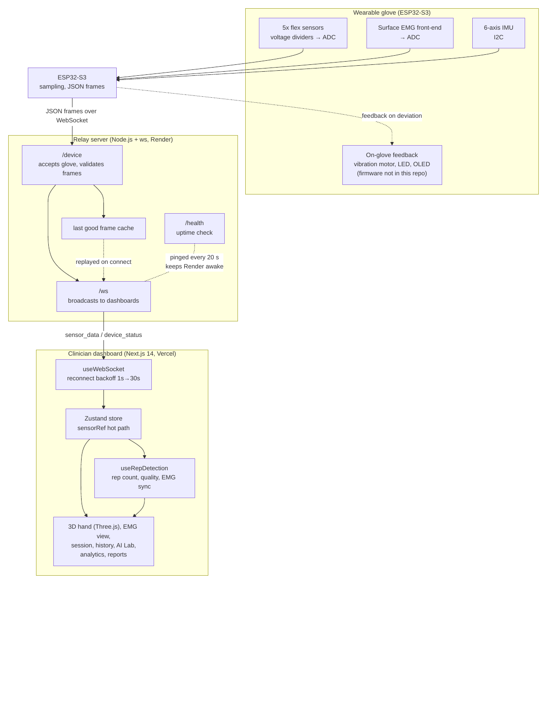

*Glove → relay server → clinician dashboard. Source files: [PDF](docs/architecture/architecture.pdf), [SVG](docs/architecture/architecture.svg), [Mermaid source](docs/architecture/architecture.mmd).*

<details>
<summary><strong>View the live Mermaid diagram (renders on GitHub)</strong></summary>

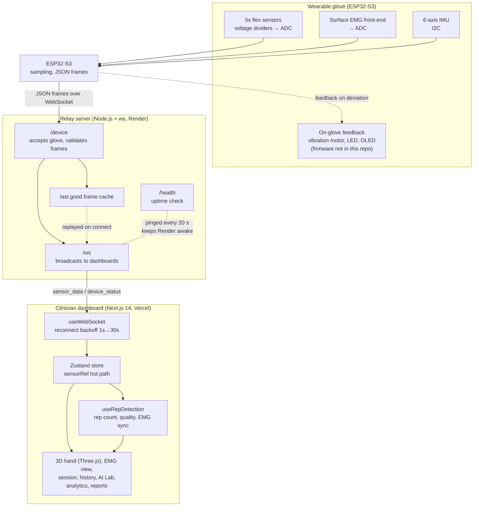

</details>

> **Note:** the slide "System Architecture & Technical Implementation" in the project deck (slide 5, [section 20](#20-presentation-and-hardware-documents)) shows an earlier planned design, with direct BLE streaming to a companion app and an on-device classifier. The diagram above reflects what is in this repository: a WebSocket relay on Render and a Next.js dashboard on Vercel.

---

## 9. Technical stack

| Layer | Technology |
|---|---|
| **Glove controller** | ESP32-S3 DevKit (dual-core 240 MHz, Wi-Fi and BLE) |
| **Finger flexion** | 5 × 2.2-inch resistive flex sensors, each in a voltage divider read by the ESP32 ADC |
| **Muscle activity** | Surface EMG front end (Muscle BioAmp Candy per the schematic), 3 Ag/AgCl electrodes on the forearm |
| **Wrist motion** | 6-axis IMU (MPU-6050, accelerometer and gyroscope) over I²C |
| **Feedback** | Vibration motor, status LED, 0.96-inch SH1106 OLED (132 × 64) over I²C |
| **Power** | 18650 Li-ion cell (3.7 V), TP4056 USB-C charging module, AMS1117-3.3 regulator |
| **Enclosure** | 3D-printed PLA |
| **Relay server** | Node.js, the `ws` WebSocket library and Node's `http` module; hosted on Render |
| **Clinician dashboard** | Next.js 14 (App Router), React 18, TypeScript, Tailwind CSS, Zustand, Three.js via `@react-three/fiber` and `@react-three/drei`, Framer Motion; hosted on Vercel |
| **Data storage** | No database in this version. The relay keeps state in memory, and the dashboard uses sample data from `lib/`. |

> The glove firmware (ESP32 code) is **not included in this repository yet** (see [Known limitations](#22-known-limitations)).

---

## 10. AI / ML model and framework details

**Honest summary:** the current build does not contain a trained machine-learning model. Its intelligence is rule-based, and a learned classifier is on the roadmap.

### What runs today

- **Rep detection** (`hooks/useRepDetection.ts`) is threshold-based with hysteresis. The mean flexion of the four long fingers is tracked.
  - A rep starts when it rises above **15°** and ends when it falls below **10°**.
  - The peak of each rep is graded: **correct** for 65° to 85°, **partial** for 30° to 65° or above 85°, and **missed** below 30°.
  - Only correct and partial reps feed the average range of motion and the consistency score, where consistency = 100 × (1 − SD / mean) of the peak values.
- **EMG and finger synchronisation.** Over a sliding window of about 150 samples, the dashboard computes the Pearson correlation between the finger-flexion signal and the EMG envelope (`emgSync`). This shows whether muscle activity and finger movement are moving together.
- **Wrist compensation.** Orientation is reconstructed from the IMU with a complementary filter in `hooks/useWebSocket.ts`, so wrist movement during an exercise can be flagged.
- **AI Lab** (`components/lab/`) is a demonstration. It compares the measured movement against ten *simulated* reference profiles:
  1. Healthy
  2. Stroke, mild
  3. Stroke, severe
  4. Parkinsonian
  5. Essential tremor
  6. Carpal tunnel
  7. Hand osteoarthritis
  8. Cerebral palsy
  9. Early motor neuron disease
  10. Diabetic neuropathy

  The profiles are labelled as simulated and are **not clinical thresholds**.

### Planned next (not yet implemented)

- **Lightweight rep-quality classifier** (Random Forest, SVM or logistic regression, trained with scikit-learn) on labelled repetitions, to flag incorrect or compensatory reps beyond fixed thresholds.
- **On-device inference on the ESP32**, so the glove can give feedback without a companion dashboard.
- **Arthritis early-warning model** for the v3 concept (see [section 7](#7-arthritis-early-forecasting-v3-concept)).

### Frameworks

| Area | In use | Planned |
|---|---|---|
| Dashboard | Next.js, React, Three.js, Zustand, Framer Motion | — |
| Relay | `ws` on Node.js | — |
| ML | — | scikit-learn (training), on-device inference on ESP32 |

---

## 11. Demo video

**▶️ [Watch the RehabGrip demo on YouTube](https://www.youtube.com/watch?v=i8S66JIVw8A)**

No hardware is needed to try the dashboard. Run it in SIM mode (see [Quick start](#12-quick-start)). A simulation panel drives the 3D hand, rep counting, EMG view, AI Lab and reports.

---

## 12. Quick start

### Option A: Dashboard in SIM mode (no hardware)

```bash
git clone <this-repo-url> rehabgrip && cd rehabgrip
npm install
npm run dev
```

Open <http://localhost:3000>. With `NEXT_PUBLIC_WS_URL` unset, the dashboard starts in **SIM mode** with an auto-cycling hand and no backend needed.

### Option B: Dashboard connected to a relay

```bash
cp .env.local.example .env.local
# edit .env.local and set NEXT_PUBLIC_WS_URL (e.g. ws://localhost:8080/ws)
npm run dev
```

Then open `/session` and click **Connect to Device**. The dashboard does **not** connect automatically on load.

### Option C: Relay server locally

```bash
cd server
npm install
npm start
```

Test it with `wscat`:

```bash
npx wscat -c ws://localhost:8080/ws
```

---

## 13. Deployment

### Relay → Render

1. Push this repository to GitHub.
2. Create a new Web Service on Render and connect the repository.
3. Root directory: `server` (already set in `server/render.yaml`).
4. Build command: `npm install`. Start command: `npm start`.
5. Copy the resulting Render URL.

### Dashboard → Vercel

1. Import the repository in Vercel and leave the root directory as the repository root.
2. Under **Settings → Environment Variables**, set `NEXT_PUBLIC_WS_URL` to `wss://<your-relay>.onrender.com/ws`. Vercel does not read `.env.local`.
3. Deploy.

### Live deployment

| Service | URL |
|---|---|
| Clinician dashboard | https://rehab-t2.vercel.app/session |
| Relay health check | https://rehab-t3-render.onrender.com/health |
| Relay WebSocket (glove) | `wss://rehab-t3-render.onrender.com/device` |

---

## 14. Data contract (relay ↔ dashboard)

| Message type | Meaning | Shape |
|---|---|---|
| `sensor_data` | Live frame from the glove | `{ deviceId, timestamp, flex:[index,middle,ring,pinky,thumb], emg:{value}, imu:{ax,ay,az,gx,gy,gz}, battery }` |
| `sensor_data_cached` | Last known frame, replayed on connect | Same shape as `sensor_data` |
| `device_status` | Connection state of the glove | `{ status: 'online' \| 'offline' \| 'stale' }` |

- **`flex`** values are calibrated angles in degrees (0 to 90), one per finger. The relay rejects frames that do not contain exactly five values in that range.
- **IMU gyro** values are in °/s. The sensor is assumed to be mounted Y-up. Orientation is derived in the browser with a complementary filter.
- **Yaw** has no magnetometer correction and drifts. Press **R** in the session view to zero it.

---

## 15. Simulation mode

Click the **⌥** control at the bottom-left of the session view to open the simulation panel.

- **SIM MODE**: toggle on or off.
- **Per-finger sliders** or presets.
- **AUTO CYCLE**: runs a demo sequence.
- **NOISE**: adds jitter.
- **SPEED**: per-frame smoothing factor (default `0.11` at 60 fps).

---

## 16. Repository layout

```
.
├── app/                       # Next.js App Router pages
│   ├── session/               → live session view (3D hand, connect/disconnect)
│   ├── emg/                   → EMG waveform view
│   ├── patients/[id], /new    → patient list, profile, intake form
│   ├── history/               → past session history
│   ├── lab/                   → AI Lab: disease simulation and AI assessment
│   ├── analytics/             → aggregate metrics and trends
│   ├── reports/[id]           → generated session and patient reports
│   ├── settings/
│   └── layout.tsx, page.tsx   → root layout and redirect to /session
│
├── components/                # SidebarLayout, SessionPage, EMGPage, PatientsPage, HistoryPage,
│   │                          #   AnalyticsPage, ReportsPage, SettingsPage, CalibrationPage,
│   │                          #   SimulationPanel, MetricsPanel, HealthKeepalive
│   ├── hand/                  # HandScene, HandModel, ConnectionOverlay, OrientationWidget
│   ├── lab/                   # DiseaseEngine, LabHandScene, EMGWaveform, TrajectoryChart, AIAssessmentPanel
│   ├── patients/, reports/    # patient and report views
│   └── ui/Toast.tsx
│
├── hooks/
│   ├── useWebSocket.ts        # connects to the relay, parses frames (auto-reconnect, 1 s → 30 s backoff)
│   └── useRepDetection.ts     # rep counts, quality grades, consistency, EMG sync
│
├── store/handStore.ts         # Zustand store (hot-path sensorRef avoids re-renders)
├── types/                     # sensor.ts, lab.types.ts
├── lib/                       # formatters, sample data, report data, utils
│
├── server/                    # WebSocket relay (deploy separately, e.g. Render)
│   ├── index.js               # /device (glove) ↔ /ws (dashboards), /health, heartbeat, frame validation
│   ├── package.json, render.yaml, README.md
│   └── docs/useWebSocket.reference.ts   # original wire-format reference (not imported)
│
├── docs/                      # presentation, slides, hardware documents, architecture diagram
├── LICENSE
├── .env.local.example
├── .gitignore
└── package.json, package-lock.json, next.config.js, tailwind.config.js, postcss.config.js, tsconfig.json
```

> **Note on `server/docs/useWebSocket.reference.ts`:** this is the original hand-off snippet from when the relay's message format was designed. The full dashboard implementation is `hooks/useWebSocket.ts`. The reference file is kept for context on the wire format and is not imported anywhere.

---

## 17. Testing and quality

| Check | How | Status |
|---|---|---|
| Frame validation | Relay rejects frames without five flex values in 0–90° | ✅ Implemented in `server/index.js` |
| Reconnect behaviour | Backoff from 1 s to 30 s | ✅ Implemented in `useWebSocket.ts` |
| Relay manual test | `wscat` against `/ws` | ✅ Documented in [Quick start](#12-quick-start) |
| Rep-detection unit tests | Feed synthetic flex traces, check counts and grades | 🗓️ Planned |
| End-to-end dashboard tests | Browser tests of SIM mode | 🗓️ Planned |
| Hardware accuracy study | Compare glove angles with a goniometer or motion-capture reference | 🗓️ Planned |

---

## 18. Security and privacy

- **No patient data is stored in this version.** The dashboard uses sample data, and the relay keeps state in memory only.
- **Transport:** the glove and dashboards connect over `wss://` (TLS) in the hosted deployment.
- **Input validation:** the relay checks frame shape and value ranges before broadcasting.
- **Secrets:** keep `.env.local` out of Git. `.env.local.example` is the only env file that should be committed.
- **Before any real patient data:** add authentication for clinicians, encrypted storage, audit logs, and a data-protection review under the applicable law (for example India's DPDP Act 2023 and HIPAA if deployed in the US). None of these exist yet.

---

## 19. Regulatory and ethical considerations

- **Not a medical device.** RehabGrip is a research and demonstration prototype. It has not been tested on patients and makes no diagnostic claims.
- **Clinician in the loop.** Any reported flag, grade or forecast is meant to support a qualified clinician, not replace their judgement.
- **Consent and transparency.** Any future patient study needs informed consent, an ethics-committee approval, and a clear explanation of what is measured.
- **Fairness.** Flex-sensor and EMG signals vary with skin, hand size, electrode placement and disease severity. Thresholds must be validated across populations before use.
- **Regulation.** Clinical use would require device classification and approval (the v3 concept suggests CDSCO). This should be confirmed with a regulatory consultant.

---

## 20. Presentation and hardware documents

Each image links to its full-resolution PDF. The complete deck is [`docs/presentation/RehabGrip_NIRMAAN2026_Presentation.pdf`](docs/presentation/RehabGrip_NIRMAAN2026_Presentation.pdf).

### Presentation

| # | Slide | Preview | PDF |
|---|---|---|---|
| 1 | Cover | 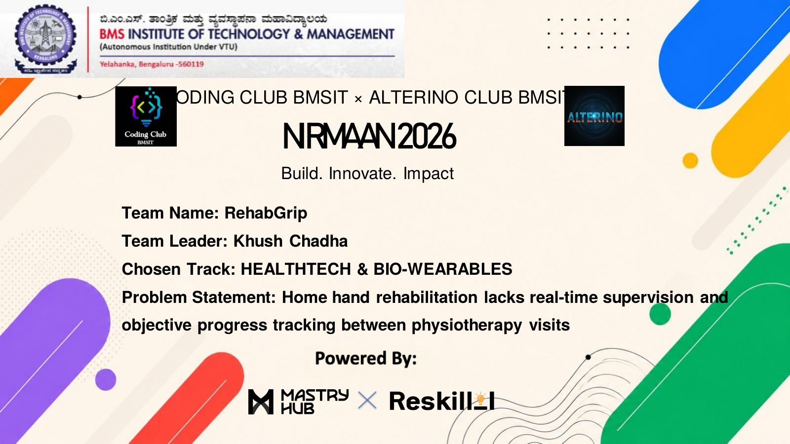 | [Open](docs/presentation/slides/01-cover.pdf) |
| 2 | Problem statement and real-world impact | 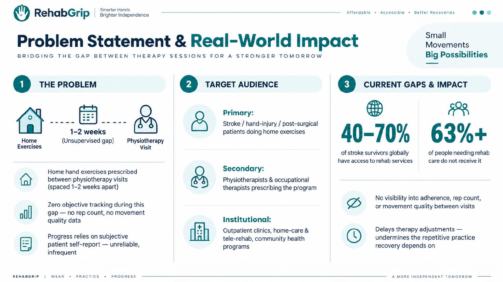 | [Open](docs/presentation/slides/02-problem-statement-and-impact.pdf) |
| 3 | Proposed solution and innovation | 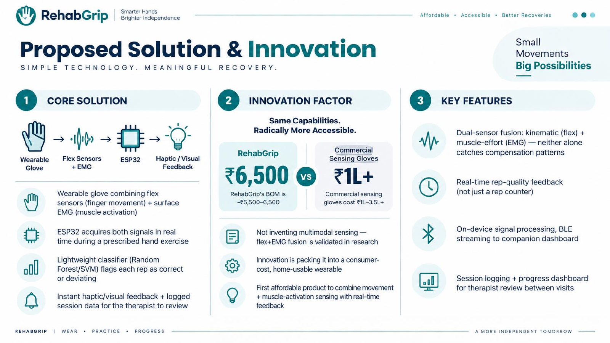 | [Open](docs/presentation/slides/03-proposed-solution-and-innovation.pdf) |
| 4 | Product vision | 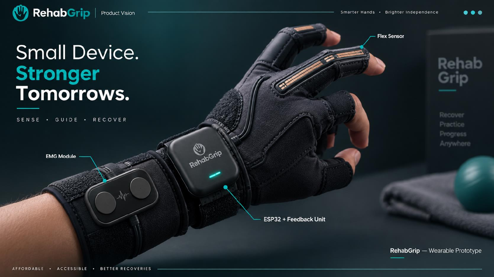 | [Open](docs/presentation/slides/04-product-vision.pdf) |
| 5 | System architecture (planned design) | 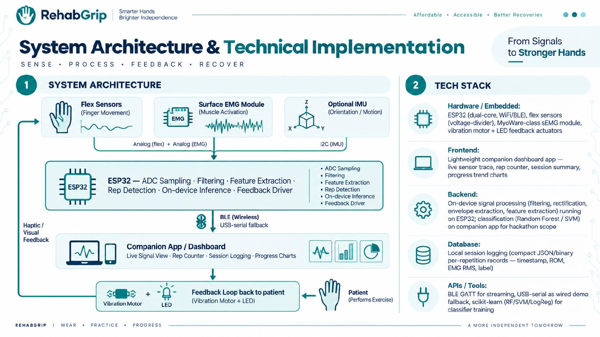 | [Open](docs/presentation/slides/05-system-architecture-planned-design.pdf) |
| 6 | Demo plan and roadmap | 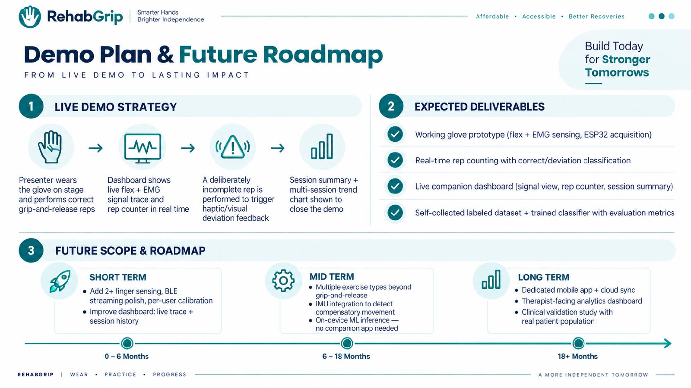 | [Open](docs/presentation/slides/06-demo-plan-and-roadmap.pdf) |
| 7 | 24-hour build scope and feasibility | 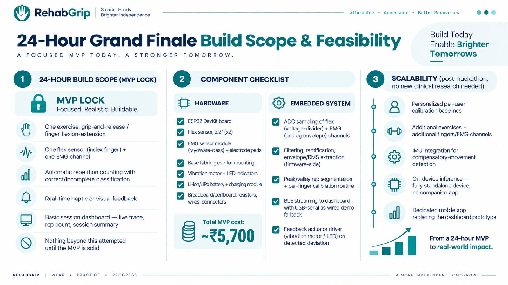 | [Open](docs/presentation/slides/07-24h-build-scope-and-feasibility.pdf) |
| 8 | Team details | 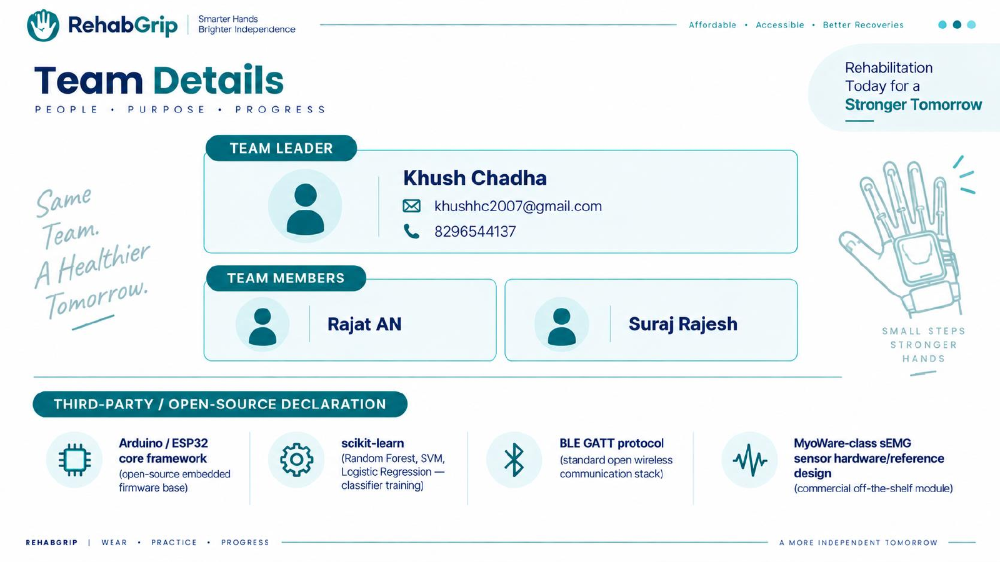 | [Open](docs/presentation/slides/08-team-details.pdf) |

### Hardware and product

| Document | Preview | PDF |
|---|---|---|
| Operator's manual and clinical guide | 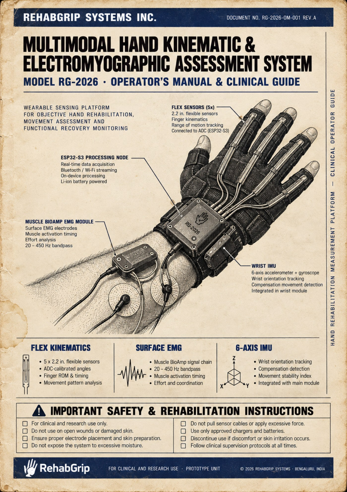 | [Open](docs/hardware-and-product/01-operator-manual-and-clinical-guide.pdf) |
| Wrist module: exploded view and parts list | 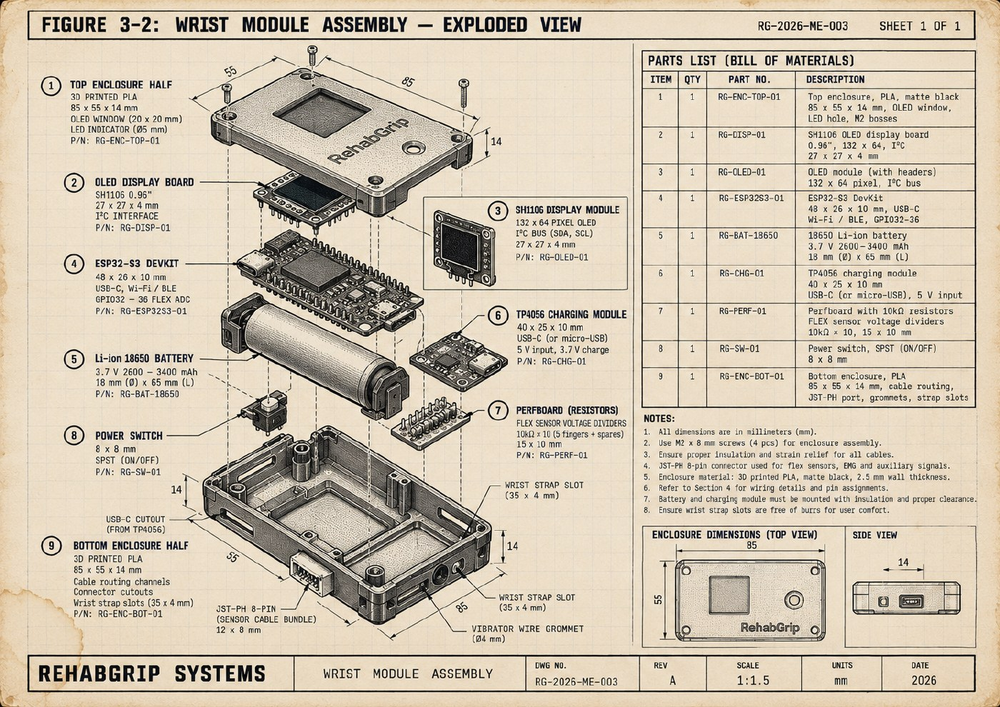 | [Open](docs/hardware-and-product/02-wrist-module-exploded-view.pdf) |
| Electrical schematic | 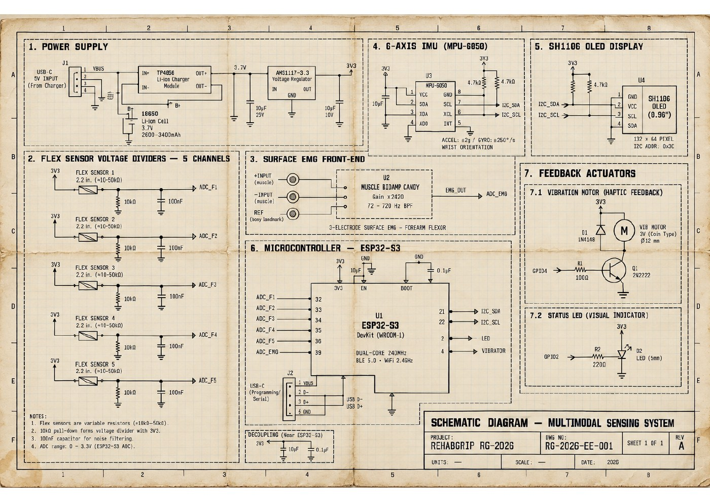 | [Open](docs/hardware-and-product/03-electrical-schematic.pdf) |
| Mechanical dimensions | 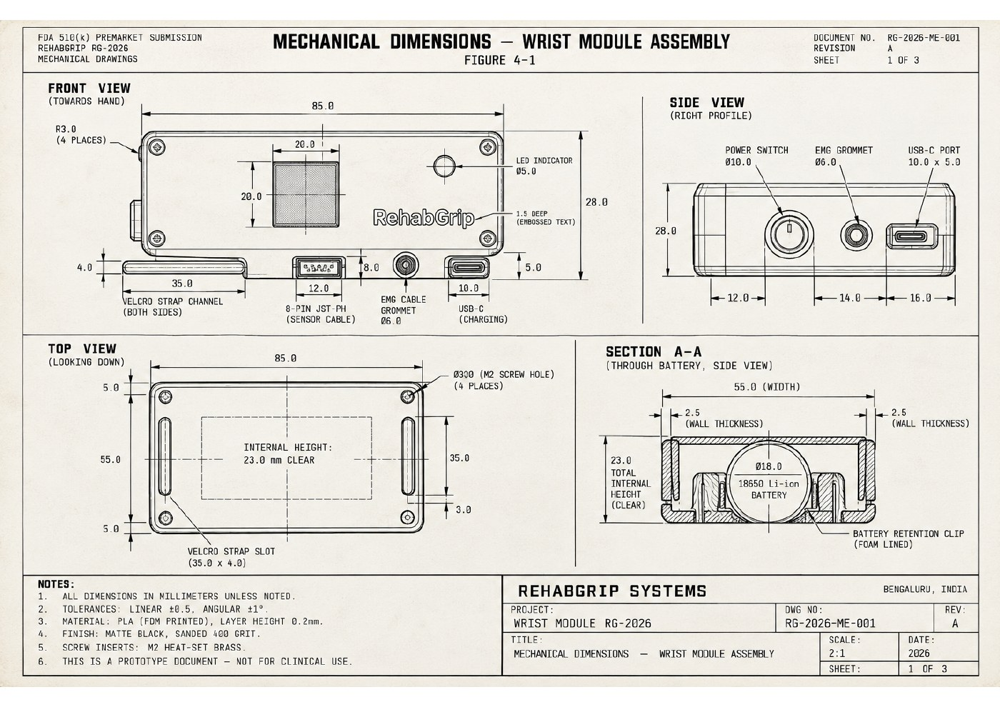 | [Open](docs/hardware-and-product/04-mechanical-dimensions.pdf) |
| Technical specification sheet | 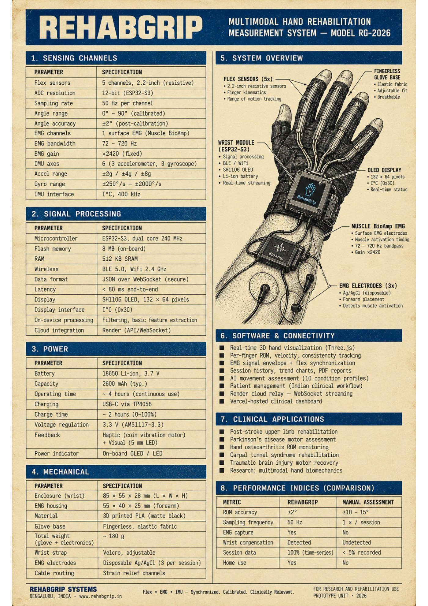 | [Open](docs/hardware-and-product/05-technical-specification-sheet.pdf) |
| Product poster: system overview | 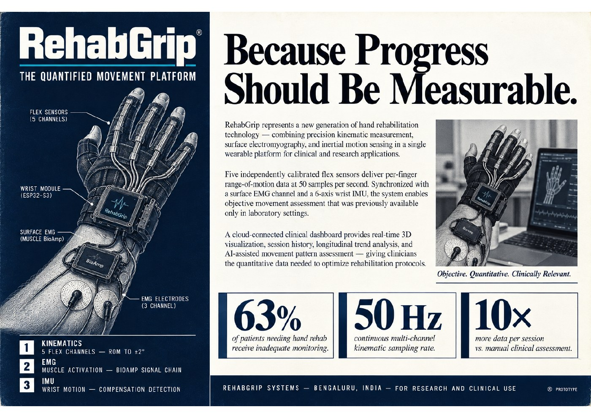 | [Open](docs/hardware-and-product/06-product-poster-system-overview.pdf) |
| Product poster: marketing | 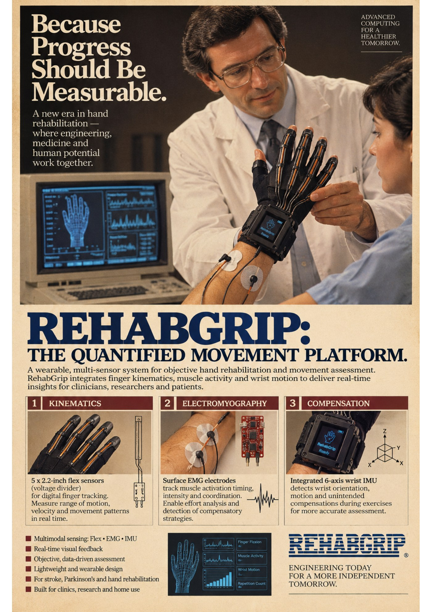 | [Open](docs/hardware-and-product/07-product-poster-marketing.pdf) |

---

## 21. Roadmap

| Horizon | Milestone |
|---|---|
| **Now (prototype)** | Live dashboard, rule-based rep grading, SIM mode, relay with frame validation |
| **Next** | Firmware in `firmware/`, rep-detection unit tests, persistent database, clinician authentication |
| **Then** | Labelled dataset collection, scikit-learn rep-quality classifier, on-device inference on ESP32 |
| **Later** | Arthritis early-forecasting pilot (v3), clinical feasibility study, regulatory pathway |

---

## 22. Known limitations

- **No trained ML model yet.** Rep quality and movement assessment use fixed rules. The learned classifier is planned.
- **Not clinically validated.** Thresholds, the AI Lab profiles and the sensing-accuracy targets in the specification sheet are design targets, not results from a clinical study.
- **Firmware is not in this repository.** The ESP32 code that reads the sensors and sends frames should be added to a `firmware/` folder.
- **Prototype hardware.** The enclosure is 3D-printed PLA, and the glove is a development unit.
- **No persistent database.** Session and patient data are sample data in this version.
- **Hosting limits.** The relay runs on Render's free tier, which can sleep. The heartbeat and `HealthKeepalive` reduce this but do not remove it.
- **Arthritis forecasting is a concept only.** Section 7 describes planned work. No arthritis model, dataset or validation exists in this repository.
- **Yaw drift.** Without a magnetometer, yaw drifts over time.

---

## 23. Licenses and third-party components

**Project code:** released under the **MIT License**. See [`LICENSE`](LICENSE).

**Main dependencies** (see `package.json` and `package-lock.json`):

| Package | License |
|---|---|
| Next.js, React, React DOM | MIT |
| Three.js, `@react-three/fiber`, `@react-three/drei` | MIT |
| Zustand, Framer Motion, Tailwind CSS | MIT |
| `ws` (relay) | MIT |
| TypeScript | Apache-2.0 |

**Embedded and hardware components**

| Component | License / note |
|---|---|
| Arduino-ESP32 core | LGPL-2.1 |
| ESP-IDF | Apache-2.0 |
| scikit-learn (planned) | BSD-3-Clause |
| Muscle BioAmp Candy (EMG front end) | Commercial module. Check its reference design before redistributing hardware files. |

### Third-party and open-source declaration

| Component | Used for | Status |
|---|---|---|
| Arduino / ESP32 core framework | Open-source embedded firmware base for the ESP32-S3 | In use (firmware not in this repo) |
| BLE GATT protocol | Open wireless standard, for planned direct glove-to-app streaming | Planned |
| scikit-learn (Random Forest, SVM, Logistic Regression) | Training the planned rep-quality classifier | Planned |
| Muscle BioAmp Candy (surface EMG front end) | Forearm EMG acquisition, per the schematic | In use (hardware) |
| Next.js, React, Three.js, Zustand, Framer Motion, Tailwind CSS, `ws` | Dashboard and relay software | In use (see `package.json`) |

**Datasets:** none. The project does not use external datasets. The AI Lab profiles are simulated and written in `components/lab/DiseaseEngine.ts`.

---

## 24. Public links

| Item | Link |
|---|---|
| ▶️ Demo video (YouTube) | https://www.youtube.com/watch?v=i8S66JIVw8A |
| Live clinician dashboard | https://rehab-t2.vercel.app/session |
| Relay health check | https://rehab-t3-render.onrender.com/health |
| Relay WebSocket (glove) | `wss://rehab-t3-render.onrender.com/device` |
| Source code | This repository |

---

## 25. FAQ

**Do I need the glove to run this?**
No. Run the dashboard in SIM mode. It drives the hand, rep counting, EMG view, AI Lab and reports from a simulation panel.

**Is the AI real machine learning?**
Not yet. Current rep detection and grading are rule-based. A learned classifier is planned, and the design is described in [section 10](#10-ai--ml-model-and-framework-details).

**Can it diagnose arthritis?**
No. The arthritis forecasting is a concept (v3) and is not implemented. The prototype is not a diagnostic tool.

**Why does the first load of the relay take a while?**
The relay runs on Render's free tier, which can sleep when idle. The keepalive reduces this but cannot fully prevent it.

**Why is the firmware missing?**
The glove firmware is still being cleaned up for release. It will be added to a `firmware/` folder.

**Why does yaw drift?**
The IMU has no magnetometer, so yaw is integrated from gyro readings only. Press **R** in the session view to zero it.

**Can I use my own sensors?**
Yes, if they send frames that match the [data contract](#14-data-contract-relay--dashboard): five flex values in 0–90°, EMG value, IMU values and battery.

---

## 26. Contributing

Contributions are welcome, especially in these areas:

- **Firmware:** ESP32 code for the sensor read-out and frame format
- **Rep detection:** unit tests with synthetic and recorded flex traces
- **Dashboard:** accessibility, responsive layout and clinician usability
- **ML:** labelled rep datasets and the rep-quality classifier
- **Docs:** clearer setup and hardware guides

Suggested workflow:

1. Fork the repository and create a branch (`feat/<short-name>`).
2. Keep changes focused, and run `npm run dev` to check the dashboard in SIM mode.
3. Open a pull request that describes what changed and how you tested it.

Please do not submit patient data or identifiable health information in issues or pull requests.

---

## 27. Changelog

| Version | Date | Notes |
|---|---|---|
| RG-2026 prototype | NIRMAAN 2026 | Glove, relay and clinician dashboard prototype with SIM mode and rule-based rep grading |
| v3 concept | Sept 2026 | Arthritis early-forecasting concept document added (not implemented) |
| README v2 | Oct 2026 | Expanded documentation: FAQ, security, roadmap, quick start, demo video |

---

## 28. Acknowledgements

- **NIRMAAN 2026**, hosted by Coding Club BMSIT × Alterino Club BMSIT and powered by Mastry Hub × Reskill
- **MS Ramaiah Institute of Technology**, Bengaluru
- The open-source maintainers of Next.js, React, Three.js, Zustand, `ws` and the other packages listed in [section 23](#23-licenses-and-third-party-components)

---

*RehabGrip is a prototype for research and demonstration only. It is not a medical device and does not replace the judgement of a qualified clinician.*
